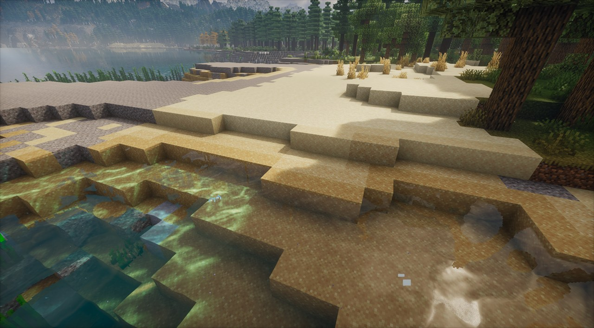

# Wet sand for Fabric

Adds wet sand (and red sand) variants
Sand need water become wet and wet sand can be smelted to get back regular sand

## About this fork

This is a modified version of [HearthianDev/wet-sand](https://github.com/HearthianDev/wet-sand),
released under the same GPL-3.0-only [LICENSE](LICENSE).

Modified here:

- Runs on Minecraft 1.21.1
- Drops vanilla overworld noise settings that conflicted with other terrain mod
- Wets the sand around water on chunk generation
- You can Smelt any wet sand in a Furnace to get regular sand back (0.0.3)

## Tested Against

Tested against Mc 1.21.1 with Neoforge 21.1.248 and Sinytra Connector

Tested with Tectonic, William Wythers' Overhauled Overworld and Continents

Used in part of my Aero Modpack